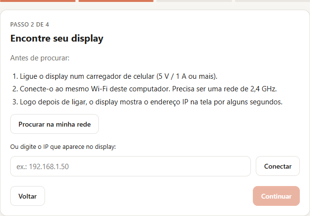
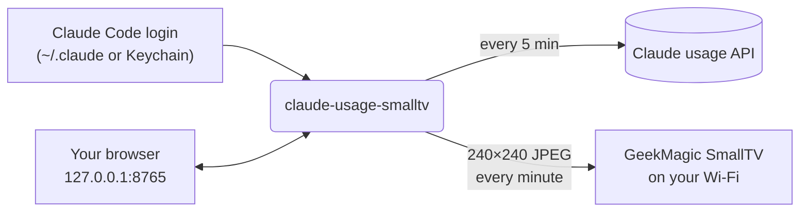

<div align="center">


# claude-usage-smalltv

**Your Claude plan usage, live on a tiny desk display.**

See how much of your 5-hour session and weekly limit you have left at a glance, without opening the app or typing `/usage`.

[](https://github.com/brunodesamachado/claude-usage-smalltv/actions/workflows/ci.yml)


[Get the display](#-get-the-display) · [Quick start](#-quick-start) · [Step-by-step tutorial](#-step-by-step-tutorial) · [Updating](#-updating) · [How it works](#-how-it-works) · [Português](README.pt-BR.md)

</div>

## ✨ Features

- **5-hour session and weekly limits** with progress bars that turn amber at 70% and red at 90%.
- **Reset countdowns**: "resets in 2h48 · 17:20" for the session, the weekday for the weekly window.
- **A clock and date**, so the display stays useful as a desk clock.
- **Where your week went**: e.g. "Claude Code 81% · Chats 19%".
- **Set up from your browser.** A local page walks you through it step by step and then shows the live status, with switches for the panel language, starting with the computer and showing the display's IP. No terminal needed.
- **Windows app, no Python needed.** Download one `.exe` and double-click it.
- **No secrets to copy.** It reuses the login Claude Code already has; the official `claude` CLI renews it.
- **No firmware flashing.** It talks to the display's stock web API over your Wi-Fi.
- **Polite to the API.** Usage is fetched every 5 minutes with exponential backoff on HTTP 429, while the clock still ticks every minute.
- **Keeps going on its own.** If the display is unplugged or drops off the Wi-Fi, the panel comes back by itself as soon as the display does.
- **Reversible.** Setup saves the display's previous photos and theme; one click puts them back.
- **English or Portuguese**, both the panel and the page.

<p align="center">
  
  <br><sub>Normal · close to the limit · last known numbers while the API is unavailable</sub>
</p>

## 📸 Photos

<!-- To use your own photos, overwrite docs/photos/photo-1.jpg, photo-2.jpg and photo-3.jpg
     (4:3 landscape looks best). To add more, copy a <td> block and point it to a new file. -->
<table>
  <tr>
    <td></td>
    <td></td>
    <td></td>
  </tr>
</table>

**Running it on your desk?** [Share a photo of your setup](../../issues/new?template=show_your_setup.yml) and it may be featured here.

## 🛒 Get the display

The panel runs on the **GeekMagic SmallTV**, a 240×240 Wi-Fi desk display about the size of a cube of sugar.

<!-- Replace YOUR-PURCHASE-LINK with your store or affiliate link. -->
**➡️ [Buy the GeekMagic SmallTV Ultra](https://s.click.aliexpress.com/e/_c3WKJDwx)**

<!-- If that is an affiliate link, keep this disclosure:
<sub>Affiliate link: buying through it supports this project at no extra cost to you.</sub>
-->

| Firmware on the display | Status |
| --- | --- |
| **SD PRO** ("Smart Weather Clock", [JUZIPi-tech/SD_PRO](https://github.com/JUZIPi-tech/SD_PRO)) | ✅ Tested |
| **GeekMagic stock firmware** (SmallTV / SmallTV-Ultra) | ⚠️ Experimental: please [report how it goes](../../issues) |

Not sure which one you have? Open `http://<display-ip>/` in a browser: SD PRO shows a **Smart Weather Clock** page with an "SD PRO" firmware section. The settings page also detects it for you.

## 🚀 Quick start

You need a **Claude Pro or Max plan** and **[Claude Code](https://code.claude.com/docs/en/overview)** signed in on the same computer.

**Windows, no Python needed**

1. Download `claude-usage-smalltv.exe` from the [latest release](../../releases/latest) and move it to a folder where it can stay (e.g. Documents): "Start with the computer" runs it from there.
2. Double-click it. The settings page opens in your browser; follow the 4 steps.

**macOS, Linux, or Windows with Python 3.10+**

```bash
pipx install git+https://github.com/brunodesamachado/claude-usage-smalltv
claude-usage-smalltv        # starts the service and opens the settings page
```

No pipx? `pip install git+https://...` works too.

## 📖 Step-by-step tutorial

<details open>
<summary><b>1. Connect the display to your Wi-Fi</b></summary>

On first boot the SmallTV creates its own Wi-Fi network. Join it from your phone, open `http://192.168.4.1`, and pick your home network. Use a **2.4 GHz** network: the display's ESP8266 chip has no 5 GHz radio.

Power it from a phone charger rated **5 V / 1 A or more**. A weak USB port makes the Wi-Fi drop out.
</details>

<details open>
<summary><b>2. Sign in to Claude Code</b></summary>

Install [Claude Code](https://code.claude.com/docs/en/overview) and run `claude` once to sign in with your Pro or Max account. That login is all this tool needs: it reads the token Claude Code stores (`~/.claude/.credentials.json`, or the Keychain on macOS) and never asks for a password, cookie or API key.
</details>

<details open>
<summary><b>3. Open the settings page</b></summary>

Double-click `claude-usage-smalltv.exe`, or run `claude-usage-smalltv` if you installed it with pipx. The page opens at **http://127.0.0.1:8765**.

> **"Windows protected your PC"?** The `.exe` is not code-signed, so SmartScreen warns about it the first time. Click **More info → Run anyway**. Every release is built by GitHub Actions from the source in this repository.
</details>

<details open>
<summary><b>4. Follow the assistant</b></summary>

<p align="center"></p>

1. **Claude login**: checked for you. If it is missing, the page tells you what to run.
2. **Find your display**: click **Search my network**, or type the IP the display shows right after power-on.
3. **Panel language**: pick one and see a live preview with your real numbers.
4. **Put the panel on the display**: it becomes the only picture on screen. Your other photos are **only hidden, never deleted**, and the previous settings are saved so you can undo everything. Leave **Start automatically** ticked so the panel keeps updating after a restart.

> **Tip:** reserve the display's IP in your router's DHCP settings, so it never changes.
</details>

<details open>
<summary><b>5. Day to day</b></summary>

Nothing to do: the clock updates every minute and the usage every 5 minutes. Open **http://127.0.0.1:8765** any time (bookmark it) to:

- see whether the display is up to date, what it shows right now and your usage;
- change the panel language, start with the computer, or **show the display's IP** in small print under the logo;
- read the recent activity, switch to another display, or **give the display back**, which restores your previous photos and theme.
</details>

## 🔄 Updating

**Windows `.exe`**: download the new version from the [latest release](../../releases/latest). Before replacing the old file, close the running copy: Task Manager → **Details** → `claude-usage-smalltv.exe` → **End task**. Then put the new file in the same place and double-click it.

**pipx**: run `pipx upgrade claude-usage-smalltv`, then restart the service:

| System | Restart command |
| --- | --- |
| Windows | `Stop-ScheduledTask claude-usage-smalltv; Start-ScheduledTask claude-usage-smalltv` |
| macOS | `launchctl kickstart -k gui/$(id -u)/dev.claude-usage-smalltv` |
| Linux | `systemctl --user restart claude-usage-smalltv` |

Your settings are kept: they live in `config.json`, outside the program (see [Configuration](#%EF%B8%8F-configuration)).

## 🔁 Start automatically

Use the **Start with the computer** switch on the settings page. It registers the service for your next sign-in (it never starts a second copy next to the running one):

| System | What the switch creates |
| --- | --- |
| Windows | A Task Scheduler task named `claude-usage-smalltv`, at logon, with no time limit, on battery too |
| macOS | `~/Library/LaunchAgents/dev.claude-usage-smalltv.plist` |
| Linux | `~/.config/systemd/user/claude-usage-smalltv.service` (logs: `journalctl --user -u claude-usage-smalltv -f`) |

On Windows the service runs without a console window; logs go to `%LOCALAPPDATA%\claude-usage-smalltv\claude-usage-smalltv.log`.

## ⌨️ Command line (advanced)

Everything the page does is also available as commands. Without `HOST`, they use the display set up last.

```bash
claude-usage-smalltv scan            # find displays on your network
claude-usage-smalltv doctor [HOST]   # read-only checks: login, usage API, display
claude-usage-smalltv preview --demo  # render the panel to a PNG, no display needed
claude-usage-smalltv setup HOST      # show only the panel on the display (undo: restore)
claude-usage-smalltv run [HOST]      # the service: updates the display and serves the page
claude-usage-smalltv restore [HOST]  # give the display back
```

```
$ claude-usage-smalltv doctor 192.168.1.50
Claude
  [ok] login            plan pro, token valid for 422 min
  [ok] usage endpoint   session 18%, weekly 46%
Display at 192.168.1.50
  [ok] network          port 80 open in 2479 ms
  [ok] firmware         SD PRO
```

## 🧠 How it works



1. **Usage**: the same data Claude Code's `/usage` command shows, from `api.anthropic.com/api/oauth/usage`, authenticated with Claude Code's own OAuth token. When the token expires, `claude auth status` (the official CLI) renews it; this tool never writes credentials.
2. **Rendering**: [Pillow](https://python-pillow.org) draws the panel. The orange spark is drawn in code, so no image assets are needed.
3. **Display**: the image is uploaded over HTTP to the display's photo storage, overwriting the previous frame. A driver per firmware is chosen automatically by probing the device. If the display stops answering, it is probed again every minute.
4. **Settings page**: the same process serves a small page and JSON API on `127.0.0.1` only, built with Python's standard library and plain JavaScript, with no extra dependencies.

The pieces are small and tested in isolation: `credentials` → `usage` → `render` → `devices` → `daemon`, driven by `service`, with `web` and `cli` on top.

## ⚙️ Configuration

The page saves its settings to `config.json` in the app's folder: `%LOCALAPPDATA%\claude-usage-smalltv` on Windows, `~/Library/Application Support/claude-usage-smalltv` on macOS, `~/.local/state/claude-usage-smalltv` on Linux. The setup backups live there too.

| Option | Default | What it does |
| --- | --- | --- |
| `HOST` argument or `SMALLTV_HOST` env var | the saved display | Display IP or hostname |
| `--lang en\|pt` or `CLAUDE_USAGE_LANG` | the saved one, else `en` | Panel language |
| `run --port PORT` | `8765` | Port of the settings page |
| `run --no-web` | — | Don't serve the settings page |
| `run --open` | — | Open the settings page in the browser (what happens when no command is given) |
| `run --usage-interval SECONDS` | `300` | How often to fetch usage. Lower values risk HTTP 429. |
| `run --once` | — | Push one frame and exit (handy for cron) |
| `--log-file PATH` | — | Also write logs to a file |
| `-v` | — | Debug logging |
| `CLAUDE_CONFIG_DIR` env var | `~/.claude` | Where Claude Code keeps its login |

Command-line values win over the saved ones, and are saved too.

## 🩺 Troubleshooting

| Symptom | Fix |
| --- | --- |
| The page says the display is not answering | Check that it is plugged in and on the Wi-Fi. Nothing else to do: the panel comes back by itself. |
| The display got a new IP | On the page, click **Change display** and search again. Then reserve the IP in your router, and turn on **Show the IP on the display** to always see it. |
| Search doesn't find the display | It may be asleep. Type the IP shown on its screen right after power-on. |
| "Windows protected your PC" | The `.exe` is not code-signed: **More info → Run anyway**. |
| The page doesn't open | The service may not be running: open the `.exe` (or `claude-usage-smalltv`) again. If port 8765 is taken, use `run --port 8766`. |
| Timeouts, several seconds per request | Normal for the ESP8266. Move it closer to the router and use a 5 V / 1 A charger. The tool retries automatically. |
| Amber footer "data from 14:07 · retrying" | The usage API is rate limiting (HTTP 429). Last known numbers stay on screen; it recovers on its own. Other tools polling `/usage` count too. |
| Red footer "sign in: run `claude`" | Claude Code is signed out. Run `claude` once. |
| Other photos still appear | Set the panel up again, or untick them on the display's photo page. |

## 🔒 Privacy and security

- Your OAuth token is read locally and sent **only** to `api.anthropic.com`. It is never logged, printed, shown on the page or written anywhere by this tool.
- The settings page listens on `127.0.0.1` only, so other devices on your network cannot open it. Requests from other websites open in your browser are refused (`Host` and `Origin` checks, JSON-only actions).
- Everything else stays on your network: the display is reached over plain HTTP on your LAN.
- The SD PRO firmware's `/config` endpoint returns your **Wi-Fi password in clear text**. This tool reads only the `theme` field from it and discards the rest.
- Endpoints that restart the display, update its firmware, change its Wi-Fi or delete files are never called.

## 🤝 Related projects

- [Claude-Code-Usage-Monitor](https://github.com/Maciek-roboblog/Claude-Code-Usage-Monitor): usage monitor for the terminal.
- [geekclock-claude](https://github.com/egerkuzma/geekclock-claude): the same display, using the claude.ai web session instead.
- [claude-usage-stick](https://github.com/oauramos/claude-usage-stick): custom ESP32 firmware for LilyGo boards.

## 🛠️ Development

```bash
git clone https://github.com/brunodesamachado/claude-usage-smalltv
cd claude-usage-smalltv
python -m venv .venv && source .venv/bin/activate   # Windows: .venv\Scripts\activate
pip install -e ".[dev]"
pytest && ruff check . && ruff format --check .
python scripts/generate_assets.py                   # regenerate docs/ images
pip install -e ".[build]" && python scripts/build_exe.py   # Windows .exe in dist/
```

Publishing a GitHub release builds the `.exe` and attaches it to the release (`.github/workflows/release.yml`). New firmware drivers are welcome: see [CONTRIBUTING.md](CONTRIBUTING.md).

## ⚖️ Disclaimer

This is an unofficial project, not affiliated with or endorsed by Anthropic or GeekMagic. "Claude" is a trademark of Anthropic. Usage data comes from an undocumented endpoint used by Claude Code, which may change without notice.

## 👤 Author

Made by **Bruno Machado**. Let's connect on [LinkedIn](https://www.linkedin.com/in/brunodesamachado).

## 📄 License

Free and open source under the [MIT License](LICENSE) © Bruno Machado.

You can use, copy, modify, merge, publish, distribute, sublicense and sell it, for personal or commercial purposes, with no fees. The only condition is keeping the copyright and license notice in copies of the code.

<div align="center">
<sub>If this made your desk a little nicer, a ⭐ helps other people find it.</sub>
</div>
