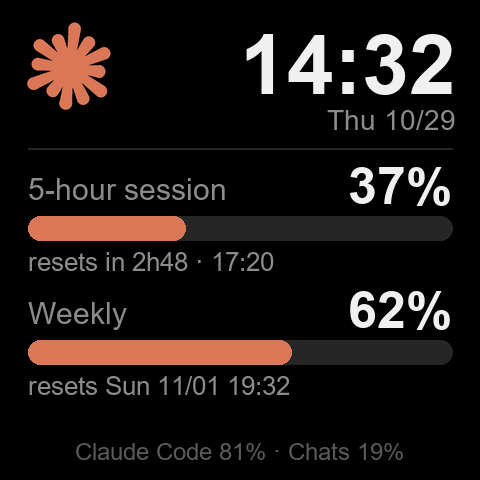
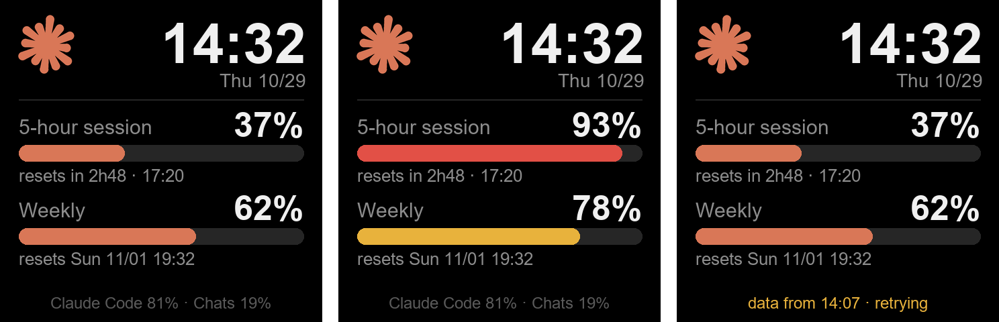
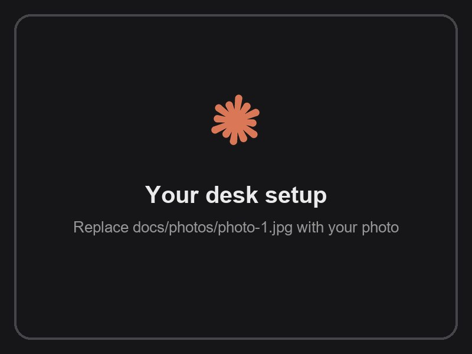
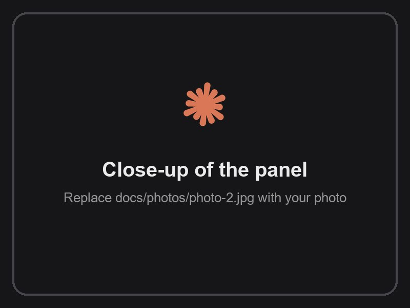
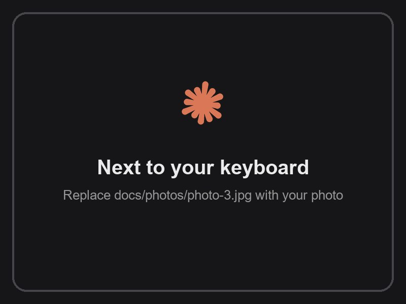
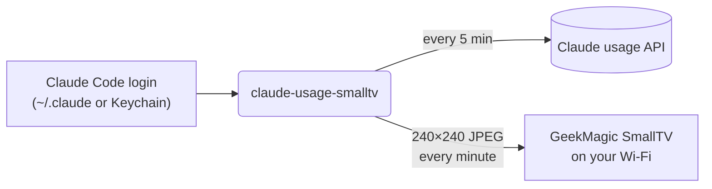

<div align="center">



# claude-usage-smalltv

**Your Claude plan usage, live on a tiny desk display.**

See how much of your 5-hour session and weekly limit you have left at a glance, without opening the app or typing `/usage`.

[](https://github.com/brunodesamachado/claude-usage-smalltv/actions/workflows/ci.yml)


[Get the display](#-get-the-display) · [Quick start](#-quick-start) · [Step-by-step tutorial](#-step-by-step-tutorial) · [How it works](#-how-it-works) · [Português](README.pt-BR.md)

</div>

## ✨ Features

- **5-hour session and weekly limits** with progress bars that turn amber at 70% and red at 90%.
- **Reset countdowns**: "resets in 2h48 · 17:20" for the session, the weekday for the weekly window.
- **A clock and date**, so the display stays useful as a desk clock.
- **Where your week went**: e.g. "Claude Code 81% · Chats 19%".
- **No secrets to copy.** It reuses the login Claude Code already has; the official `claude` CLI renews it.
- **No firmware flashing.** It talks to the display's stock web API over your Wi-Fi.
- **Polite to the API.** Usage is fetched every 5 minutes with exponential backoff on HTTP 429, while the clock still ticks every minute.
- **Reversible.** `setup` saves the display's previous photos and theme; `restore` puts them back.
- **English or Portuguese** panel (`--lang en|pt`).

<p align="center">
  
  <br><sub>Normal · close to the limit · last known numbers while the API is unavailable</sub>
</p>

## 📸 Photos

<!-- To use your own photos, overwrite docs/photos/photo-1.jpg, photo-2.jpg and photo-3.jpg
     (4:3 landscape looks best). To add more, copy a <td> block and point it to a new file. -->
<table>
  <tr>
    <td></td>
    <td></td>
    <td></td>
  </tr>
</table>

**Running it on your desk?** [Share a photo of your setup](../../issues/new?template=show_your_setup.yml) and it may be featured here.

## 🛒 Get the display

The panel runs on the **GeekMagic SmallTV**, a 240×240 Wi-Fi desk display about the size of a cube of sugar.

<!-- Replace YOUR-PURCHASE-LINK with your store or affiliate link. -->
**➡️ [Buy the GeekMagic SmallTV Ultra](https://YOUR-PURCHASE-LINK)**

<!-- If that is an affiliate link, keep this disclosure:
<sub>Affiliate link: buying through it supports this project at no extra cost to you.</sub>
-->

| Firmware on the display | Status |
| --- | --- |
| **SD PRO** ("Smart Weather Clock", [JUZIPi-tech/SD_PRO](https://github.com/JUZIPi-tech/SD_PRO)) | ✅ Tested |
| **GeekMagic stock firmware** (SmallTV / SmallTV-Ultra) | ⚠️ Experimental: please [report how it goes](../../issues) |

Not sure which one you have? Open `http://<display-ip>/` in a browser: SD PRO shows a **Smart Weather Clock** page with an "SD PRO" firmware section. The tool also detects it for you (`doctor`).

## 🚀 Quick start

You need **Python 3.10+**, a **Claude Pro or Max plan**, and **[Claude Code](https://code.claude.com/docs/en/overview)** signed in on the same computer.

```bash
pipx install git+https://github.com/brunodesamachado/claude-usage-smalltv
claude-usage-smalltv doctor 192.168.1.50     # check login, usage API and display
claude-usage-smalltv setup 192.168.1.50      # show only the panel (undo: restore)
claude-usage-smalltv run 192.168.1.50        # keep it updated
```

Replace `192.168.1.50` with your display's IP. No pipx? `pip install git+https://...` works too.

## 📖 Step-by-step tutorial

<details open>
<summary><b>1. Connect the display to your Wi-Fi</b></summary>

On first boot the SmallTV creates its own Wi-Fi network. Join it from your phone, open `http://192.168.4.1`, and pick your home network. Use a **2.4 GHz** network: the display's ESP8266 chip has no 5 GHz radio.

Power it from a phone charger rated **5 V / 1 A or more**. A weak USB port makes the Wi-Fi drop out.
</details>

<details open>
<summary><b>2. Find the display's IP address</b></summary>

The IP shows on screen for a few seconds after power-on. You can also scan your network:

```bash
claude-usage-smalltv scan
```

```
Scanning your network for displays (port 80)...
  192.168.1.50     Smart Weather Clock  <- SmallTV
  192.168.1.1      Router
```

> **Tip:** reserve that IP for the display in your router's DHCP settings, so it never changes.
</details>

<details open>
<summary><b>3. Sign in to Claude Code</b></summary>

Install [Claude Code](https://code.claude.com/docs/en/overview) and run `claude` once to sign in with your Pro or Max account. That login is all this tool needs: it reads the token Claude Code stores (`~/.claude/.credentials.json`, or the Keychain on macOS) and never asks for a password, cookie or API key.
</details>

<details open>
<summary><b>4. Install claude-usage-smalltv</b></summary>

```bash
pipx install git+https://github.com/brunodesamachado/claude-usage-smalltv
```

Then check that everything is reachable. `doctor` only reads, it changes nothing:

```bash
claude-usage-smalltv doctor 192.168.1.50
```

```
Claude
  [ok] login            plan pro, token valid for 422 min
  [ok] usage endpoint   session 18%, weekly 46%
Display at 192.168.1.50
  [ok] network          port 80 open in 2479 ms
  [ok] firmware         SD PRO
```
</details>

<details open>
<summary><b>5. Preview the panel (optional)</b></summary>

```bash
claude-usage-smalltv preview              # your real numbers → claude-usage-preview.png
claude-usage-smalltv preview --demo       # sample numbers, no login needed
claude-usage-smalltv preview --lang pt    # Portuguese labels
```
</details>

<details open>
<summary><b>6. Put the panel on the display</b></summary>

```bash
claude-usage-smalltv setup 192.168.1.50
```

This uploads the panel, makes it the only photo in the slideshow and switches the display to its photo theme. Your other photos are **only unticked, never deleted**, and the previous settings are saved so you can undo everything later.
</details>

<details open>
<summary><b>7. Keep it updated</b></summary>

```bash
claude-usage-smalltv run 192.168.1.50
```

Leave it running: the clock updates every minute and the usage numbers every 5 minutes. Stop with `Ctrl+C`. To make it start on its own, see [Start automatically](#-start-automatically).
</details>

<details open>
<summary><b>8. Undo (any time)</b></summary>

```bash
claude-usage-smalltv restore 192.168.1.50
```

Your previous photos and theme come back. The panel image stays on the display's storage; delete it from the display's web page if you like.
</details>

## 🔁 Start automatically

<details>
<summary><b>Windows</b> (Task Scheduler)</summary>

`claude-usage-smalltvw` is the same command without a console window; logs go to `%LOCALAPPDATA%\claude-usage-smalltv\claude-usage-smalltv.log`. Run in PowerShell:

```powershell
$exe = (Get-Command claude-usage-smalltvw).Source
$action = New-ScheduledTaskAction -Execute $exe -Argument "run 192.168.1.50"
$trigger = New-ScheduledTaskTrigger -AtLogOn -User $env:USERNAME
$settings = New-ScheduledTaskSettingsSet -AllowStartIfOnBatteries -DontStopIfGoingOnBatteries `
  -ExecutionTimeLimit ([TimeSpan]::Zero) -RestartCount 999 -RestartInterval (New-TimeSpan -Minutes 1)
Register-ScheduledTask -TaskName "claude-usage-smalltv" -Action $action -Trigger $trigger -Settings $settings
```

Remove it with `Unregister-ScheduledTask -TaskName "claude-usage-smalltv"`.
</details>

<details>
<summary><b>macOS</b> (launchd)</summary>

Save as `~/Library/LaunchAgents/dev.claude-usage-smalltv.plist`, replacing the path (from `which claude-usage-smalltv`) and the IP:

```xml
<?xml version="1.0" encoding="UTF-8"?>
<!DOCTYPE plist PUBLIC "-//Apple//DTD PLIST 1.0//EN" "http://www.apple.com/DTDs/PropertyList-1.0.dtd">
<plist version="1.0">
<dict>
  <key>Label</key><string>dev.claude-usage-smalltv</string>
  <key>ProgramArguments</key>
  <array>
    <string>/Users/you/.local/bin/claude-usage-smalltv</string>
    <string>run</string>
    <string>192.168.1.50</string>
  </array>
  <key>RunAtLoad</key><true/>
  <key>KeepAlive</key><true/>
  <key>StandardErrorPath</key><string>/tmp/claude-usage-smalltv.log</string>
</dict>
</plist>
```

```bash
launchctl load ~/Library/LaunchAgents/dev.claude-usage-smalltv.plist
```
</details>

<details>
<summary><b>Linux</b> (systemd user service)</summary>

Save as `~/.config/systemd/user/claude-usage-smalltv.service`:

```ini
[Unit]
Description=Claude usage on GeekMagic SmallTV
After=network-online.target

[Service]
ExecStart=%h/.local/bin/claude-usage-smalltv run 192.168.1.50
Restart=always
RestartSec=60

[Install]
WantedBy=default.target
```

```bash
systemctl --user enable --now claude-usage-smalltv
journalctl --user -u claude-usage-smalltv -f   # logs
```
</details>

## 🧠 How it works



1. **Usage**: the same data Claude Code's `/usage` command shows, from `api.anthropic.com/api/oauth/usage`, authenticated with Claude Code's own OAuth token. When the token expires, `claude auth status` (the official CLI) renews it; this tool never writes credentials.
2. **Rendering**: [Pillow](https://python-pillow.org) draws the panel. The orange spark is drawn in code, so no image assets are needed.
3. **Display**: the image is uploaded over HTTP to the display's photo storage, overwriting the previous frame. A driver per firmware is chosen automatically by probing the device.

The pieces are small and tested in isolation: `credentials` → `usage` → `render` → `devices` → `daemon`, all wired up by `cli`.

## ⚙️ Configuration

| Option | Default | What it does |
| --- | --- | --- |
| `HOST` argument or `SMALLTV_HOST` env var | — | Display IP or hostname |
| `--lang en\|pt` or `CLAUDE_USAGE_LANG` | `en` | Panel language |
| `run --usage-interval SECONDS` | `300` | How often to fetch usage. Lower values risk HTTP 429. |
| `run --once` | — | Push one frame and exit (handy for cron) |
| `--log-file PATH` | — | Also write logs to a file |
| `-v` | — | Debug logging |
| `CLAUDE_CONFIG_DIR` env var | `~/.claude` | Where Claude Code keeps its login |

## 🩺 Troubleshooting

| Symptom | Fix |
| --- | --- |
| `scan` doesn't find the display | It may be asleep. Read the IP on its screen after power-on and pass it directly. |
| Timeouts, several seconds per request | Normal for the ESP8266. Move it closer to the router and use a 5 V / 1 A charger. The tool retries automatically. |
| Amber footer "data from 14:07 · retrying" | The usage API is rate limiting (HTTP 429). Last known numbers stay on screen; it recovers on its own. Other tools polling `/usage` count too. |
| Red footer "sign in: run `claude`" | Claude Code is signed out. Run `claude` once. |
| Other photos still appear | Run `setup` again, or untick them on the display's photo page. |
| The display got a new IP | Reserve its IP in your router, then update the command or scheduled task. |

## 🔒 Privacy and security

- Your OAuth token is read locally and sent **only** to `api.anthropic.com`. It is never logged, printed or written anywhere by this tool.
- Everything else stays on your network: the display is reached over plain HTTP on your LAN.
- The SD PRO firmware's `/config` endpoint returns your **Wi-Fi password in clear text**. This tool reads only the `theme` field from it and discards the rest.
- Endpoints that restart the display, update its firmware, change its Wi-Fi or delete files are never called.

## 🤝 Related projects

- [Claude-Code-Usage-Monitor](https://github.com/Maciek-roboblog/Claude-Code-Usage-Monitor): usage monitor for the terminal.
- [geekclock-claude](https://github.com/egerkuzma/geekclock-claude): the same display, using the claude.ai web session instead.
- [claude-usage-stick](https://github.com/oauramos/claude-usage-stick): custom ESP32 firmware for LilyGo boards.

## 🛠️ Development

```bash
git clone https://github.com/brunodesamachado/claude-usage-smalltv
cd claude-usage-smalltv
python -m venv .venv && source .venv/bin/activate   # Windows: .venv\Scripts\activate
pip install -e ".[dev]"
pytest && ruff check . && ruff format --check .
python scripts/generate_assets.py                   # regenerate docs/ images
```

New firmware drivers are welcome: see [CONTRIBUTING.md](CONTRIBUTING.md).

## ⚖️ Disclaimer

This is an unofficial project, not affiliated with or endorsed by Anthropic or GeekMagic. "Claude" is a trademark of Anthropic. Usage data comes from an undocumented endpoint used by Claude Code, which may change without notice.

## 👤 Author

Made by **Bruno Machado**. Let's connect on [LinkedIn](https://www.linkedin.com/in/brunodesamachado).

## 📄 License

Free and open source under the [MIT License](LICENSE) © Bruno Machado.

You can use, copy, modify, merge, publish, distribute, sublicense and sell it, for personal or commercial purposes, with no fees. The only condition is keeping the copyright and license notice in copies of the code.

<div align="center">
<sub>If this made your desk a little nicer, a ⭐ helps other people find it.</sub>
</div>
