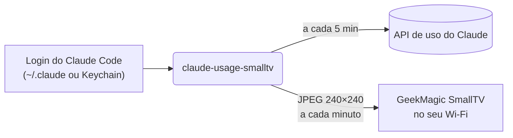

<div align="center">


# claude-usage-smalltv

**O consumo do seu plano Claude, ao vivo num display minúsculo na sua mesa.**

Veja quanto resta da sessão de 5 horas e do limite semanal com uma olhada, sem abrir o app nem digitar `/usage`.

[](https://github.com/brunodesamachado/claude-usage-smalltv/actions/workflows/ci.yml)


[Comprar o display](#-comprar-o-display) · [Início rápido](#-início-rápido) · [Tutorial passo a passo](#-tutorial-passo-a-passo) · [Como funciona](#-como-funciona) · [English](README.md)

</div>

## ✨ Recursos

- **Sessão de 5 horas e limite semanal**, com barras que ficam amarelas em 70% e vermelhas em 90%.
- **Contagem regressiva**: "renova em 2h48 · 17:20" na sessão e o dia da semana no limite semanal.
- **Relógio e data**, para o display continuar útil como relógio de mesa.
- **Para onde foi a sua semana**: por exemplo "Claude Code 81% · Chats 19%".
- **Nenhum segredo para copiar.** Usa o login que o Claude Code já tem, renovado pelo próprio CLI `claude`.
- **Sem gravar firmware.** Conversa com a API web original do display pelo Wi-Fi.
- **Educado com a API.** O uso é consultado a cada 5 minutos, com recuo progressivo em caso de HTTP 429, enquanto o relógio continua mudando a cada minuto.
- **Reversível.** O `setup` guarda as fotos e o tema anteriores do display; o `restore` devolve tudo.
- Painel em **inglês ou português** (`--lang en|pt`).

<p align="center">
  
  <br><sub>Normal · perto do limite · últimos números conhecidos enquanto a API está indisponível</sub>
</p>

## 📸 Fotos

<!-- Para usar suas fotos, substitua docs/photos/photo-1.jpg, photo-2.jpg e photo-3.jpg
     (paisagem 4:3 fica melhor). Para mais fotos, copie um bloco <td> e aponte para um arquivo novo. -->
<table>
  <tr>
    <td></td>
    <td></td>
    <td></td>
  </tr>
</table>

**Está usando na sua mesa?** [Mande uma foto do seu setup](../../issues/new?template=show_your_setup.yml) e ela pode aparecer aqui.

## 🛒 Comprar o display

O painel roda no **GeekMagic SmallTV**, um display Wi-Fi de 240×240 do tamanho de um cubo de açúcar.

<!-- Troque YOUR-PURCHASE-LINK pelo seu link de loja ou de afiliado. -->
**➡️ [Comprar o GeekMagic SmallTV Ultra](https://YOUR-PURCHASE-LINK)**

<!-- Se for link de afiliado, mantenha o aviso:
<sub>Link de afiliado: comprando por ele você apoia o projeto sem pagar nada a mais.</sub>
-->

| Firmware do display | Situação |
| --- | --- |
| **SD PRO** ("Smart Weather Clock", [JUZIPi-tech/SD_PRO](https://github.com/JUZIPi-tech/SD_PRO)) | ✅ Testado |
| **Firmware original GeekMagic** (SmallTV / SmallTV-Ultra) | ⚠️ Experimental: [conte como foi](../../issues) |

Não sabe qual é o seu? Abra `http://<ip-do-display>/` no navegador: o SD PRO mostra a página **Smart Weather Clock**, com uma seção de firmware "SD PRO". A ferramenta também detecta sozinha (`doctor`).

## 🚀 Início rápido

Você precisa de **Python 3.10+**, um **plano Claude Pro ou Max** e o **[Claude Code](https://code.claude.com/docs/en/overview)** com login feito no mesmo computador.

```bash
pipx install git+https://github.com/brunodesamachado/claude-usage-smalltv
claude-usage-smalltv doctor 192.168.1.50     # confere login, API de uso e display
claude-usage-smalltv setup 192.168.1.50      # deixa só o painel na tela (desfazer: restore)
claude-usage-smalltv run 192.168.1.50        # mantém atualizado
```

Troque `192.168.1.50` pelo IP do seu display. Sem pipx? `pip install git+https://...` também funciona.

## 📖 Tutorial passo a passo

<details open>
<summary><b>1. Conecte o display ao Wi-Fi</b></summary>

Na primeira vez que liga, o SmallTV cria uma rede Wi-Fi própria. Conecte o celular nela, abra `http://192.168.4.1` e escolha a rede da sua casa. Use uma rede de **2,4 GHz**: o chip ESP8266 do display não tem 5 GHz.

Alimente com um carregador de celular de **5 V / 1 A ou mais**. Porta USB fraca faz o Wi-Fi cair.
</details>

<details open>
<summary><b>2. Descubra o IP do display</b></summary>

O IP aparece na tela por alguns segundos depois de ligar. Você também pode procurar na rede:

```bash
claude-usage-smalltv scan
```

```
Scanning your network for displays (port 80)...
  192.168.1.50     Smart Weather Clock  <- SmallTV
  192.168.1.1      Router
```

> **Dica:** reserve esse IP para o display no DHCP do roteador, assim ele nunca muda.
</details>

<details open>
<summary><b>3. Faça login no Claude Code</b></summary>

Instale o [Claude Code](https://code.claude.com/docs/en/overview) e rode `claude` uma vez para entrar com sua conta Pro ou Max. Esse login é tudo de que a ferramenta precisa: ela lê o token que o Claude Code guarda (`~/.claude/.credentials.json`, ou o Keychain no macOS) e nunca pede senha, cookie ou chave de API.
</details>

<details open>
<summary><b>4. Instale o claude-usage-smalltv</b></summary>

```bash
pipx install git+https://github.com/brunodesamachado/claude-usage-smalltv
```

Depois confira se tudo responde. O `doctor` só lê, não muda nada:

```bash
claude-usage-smalltv doctor 192.168.1.50
```

```
Claude
  [ok] login            plan pro, token valid for 422 min
  [ok] usage endpoint   session 18%, weekly 46%
Display at 192.168.1.50
  [ok] network          port 80 open in 2479 ms
  [ok] firmware         SD PRO
```
</details>

<details open>
<summary><b>5. Veja uma prévia (opcional)</b></summary>

```bash
claude-usage-smalltv preview --lang pt          # seus números reais → claude-usage-preview.png
claude-usage-smalltv preview --demo --lang pt   # números de exemplo, sem login
```
</details>

<details open>
<summary><b>6. Coloque o painel no display</b></summary>

```bash
claude-usage-smalltv setup 192.168.1.50 --lang pt
```

Isso envia o painel, deixa ele como única foto do rodízio e muda o display para o tema de fotos. Suas outras fotos são **só desmarcadas, nunca apagadas**, e as configurações anteriores ficam salvas para você desfazer tudo depois.
</details>

<details open>
<summary><b>7. Mantenha atualizado</b></summary>

```bash
claude-usage-smalltv run 192.168.1.50 --lang pt
```

Deixe rodando: o relógio atualiza a cada minuto e os números de uso a cada 5 minutos. Para parar, `Ctrl+C`. Para iniciar sozinho, veja [Iniciar automaticamente](#-iniciar-automaticamente).
</details>

<details open>
<summary><b>8. Desfazer (a qualquer momento)</b></summary>

```bash
claude-usage-smalltv restore 192.168.1.50
```

Suas fotos e o tema anteriores voltam. A imagem do painel continua no armazenamento do display; apague pela página web dele se quiser.
</details>

## 🔁 Iniciar automaticamente

<details>
<summary><b>Windows</b> (Agendador de Tarefas)</summary>

`claude-usage-smalltvw` é o mesmo comando sem janela de console; os logs vão para `%LOCALAPPDATA%\claude-usage-smalltv\claude-usage-smalltv.log`. No PowerShell:

```powershell
$exe = (Get-Command claude-usage-smalltvw).Source
$action = New-ScheduledTaskAction -Execute $exe -Argument "run 192.168.1.50 --lang pt"
$trigger = New-ScheduledTaskTrigger -AtLogOn -User $env:USERNAME
$settings = New-ScheduledTaskSettingsSet -AllowStartIfOnBatteries -DontStopIfGoingOnBatteries `
  -ExecutionTimeLimit ([TimeSpan]::Zero) -RestartCount 999 -RestartInterval (New-TimeSpan -Minutes 1)
Register-ScheduledTask -TaskName "claude-usage-smalltv" -Action $action -Trigger $trigger -Settings $settings
```

Para remover: `Unregister-ScheduledTask -TaskName "claude-usage-smalltv"`.
</details>

<details>
<summary><b>macOS</b> (launchd)</summary>

Salve como `~/Library/LaunchAgents/dev.claude-usage-smalltv.plist`, trocando o caminho (veja com `which claude-usage-smalltv`) e o IP:

```xml
<?xml version="1.0" encoding="UTF-8"?>
<!DOCTYPE plist PUBLIC "-//Apple//DTD PLIST 1.0//EN" "http://www.apple.com/DTDs/PropertyList-1.0.dtd">
<plist version="1.0">
<dict>
  <key>Label</key><string>dev.claude-usage-smalltv</string>
  <key>ProgramArguments</key>
  <array>
    <string>/Users/voce/.local/bin/claude-usage-smalltv</string>
    <string>run</string>
    <string>192.168.1.50</string>
    <string>--lang</string>
    <string>pt</string>
  </array>
  <key>RunAtLoad</key><true/>
  <key>KeepAlive</key><true/>
  <key>StandardErrorPath</key><string>/tmp/claude-usage-smalltv.log</string>
</dict>
</plist>
```

```bash
launchctl load ~/Library/LaunchAgents/dev.claude-usage-smalltv.plist
```
</details>

<details>
<summary><b>Linux</b> (serviço systemd do usuário)</summary>

Salve como `~/.config/systemd/user/claude-usage-smalltv.service`:

```ini
[Unit]
Description=Claude usage on GeekMagic SmallTV
After=network-online.target

[Service]
ExecStart=%h/.local/bin/claude-usage-smalltv run 192.168.1.50 --lang pt
Restart=always
RestartSec=60

[Install]
WantedBy=default.target
```

```bash
systemctl --user enable --now claude-usage-smalltv
journalctl --user -u claude-usage-smalltv -f   # logs
```
</details>

## 🧠 Como funciona



1. **Uso**: os mesmos dados do comando `/usage` do Claude Code, vindos de `api.anthropic.com/api/oauth/usage` e autenticados com o próprio token OAuth do Claude Code. Quando o token vence, o `claude auth status` (CLI oficial) renova; esta ferramenta nunca grava credenciais.
2. **Desenho**: o [Pillow](https://python-pillow.org) desenha o painel. O símbolo laranja é desenhado em código, sem arquivos de imagem.
3. **Display**: a imagem é enviada por HTTP para o armazenamento de fotos do display, sobrescrevendo o quadro anterior. O driver de cada firmware é escolhido automaticamente sondando o aparelho.

As partes são pequenas e testadas isoladamente: `credentials` → `usage` → `render` → `devices` → `daemon`, ligadas pelo `cli`.

## ⚙️ Configuração

| Opção | Padrão | O que faz |
| --- | --- | --- |
| Argumento `HOST` ou variável `SMALLTV_HOST` | — | IP ou nome do display |
| `--lang en\|pt` ou `CLAUDE_USAGE_LANG` | `en` | Idioma do painel |
| `run --usage-interval SEGUNDOS` | `300` | Frequência da consulta de uso. Valores menores arriscam HTTP 429. |
| `run --once` | — | Envia um quadro e sai (útil com cron) |
| `--log-file CAMINHO` | — | Também grava os logs num arquivo |
| `-v` | — | Logs detalhados |
| Variável `CLAUDE_CONFIG_DIR` | `~/.claude` | Onde o Claude Code guarda o login |

## 🩺 Solução de problemas

| Sintoma | Solução |
| --- | --- |
| O `scan` não acha o display | Ele pode estar dormindo. Leia o IP na tela logo depois de ligar e passe direto. |
| Timeouts, vários segundos por requisição | Normal no ESP8266. Aproxime do roteador e use um carregador de 5 V / 1 A. A ferramenta tenta de novo sozinha. |
| Rodapé amarelo "dados de 14:07 · tentando de novo" | A API de uso está limitando as requisições (HTTP 429). Os últimos números ficam na tela e tudo volta sozinho. Outras ferramentas consultando `/usage` também contam. |
| Rodapé vermelho "faça login: rode `claude`" | O Claude Code saiu da conta. Rode `claude` uma vez. |
| Outras fotos continuam aparecendo | Rode o `setup` de novo ou desmarque-as na página de fotos do display. |
| O display ganhou outro IP | Reserve o IP no roteador e atualize o comando ou a tarefa agendada. |

## 🔒 Privacidade e segurança

- Seu token OAuth é lido localmente e enviado **apenas** para `api.anthropic.com`. Esta ferramenta nunca o registra em log, imprime ou grava.
- O resto fica na sua rede: o display é acessado por HTTP na sua LAN.
- O endpoint `/config` do firmware SD PRO devolve a **senha do seu Wi-Fi em texto puro**. Esta ferramenta lê só o campo `theme` e descarta o resto.
- Endpoints que reiniciam o display, atualizam firmware, mudam o Wi-Fi ou apagam arquivos nunca são chamados.

## 🤝 Projetos relacionados

- [Claude-Code-Usage-Monitor](https://github.com/Maciek-roboblog/Claude-Code-Usage-Monitor): monitor de uso no terminal.
- [geekclock-claude](https://github.com/egerkuzma/geekclock-claude): o mesmo display, usando a sessão web do claude.ai.
- [claude-usage-stick](https://github.com/oauramos/claude-usage-stick): firmware próprio de ESP32 para placas LilyGo.

## 🛠️ Desenvolvimento

```bash
git clone https://github.com/brunodesamachado/claude-usage-smalltv
cd claude-usage-smalltv
python -m venv .venv && source .venv/bin/activate   # Windows: .venv\Scripts\activate
pip install -e ".[dev]"
pytest && ruff check . && ruff format --check .
python scripts/generate_assets.py                   # regera as imagens de docs/
```

Drivers para novos firmwares são bem-vindos: veja o [CONTRIBUTING.md](CONTRIBUTING.md).

## ⚖️ Aviso

Projeto não oficial, sem vínculo com a Anthropic ou a GeekMagic e sem endosso delas. "Claude" é marca registrada da Anthropic. Os dados de uso vêm de um endpoint não documentado usado pelo Claude Code, que pode mudar sem aviso.

## 👤 Autor

Feito por **Bruno Machado**. Vamos nos conectar no [LinkedIn](https://www.linkedin.com/in/brunodesamachado).

## 📄 Licença

Livre e de código aberto, sob a [Licença MIT](LICENSE) © Bruno Machado.

Você pode usar, copiar, modificar, mesclar, publicar, distribuir, sublicenciar e vender, para uso pessoal ou comercial, sem pagar nada. A única condição é manter o aviso de copyright e de licença nas cópias do código.

<div align="center">
<sub>Se isso deixou sua mesa um pouco mais legal, uma ⭐ ajuda outras pessoas a encontrarem o projeto.</sub>
</div>
