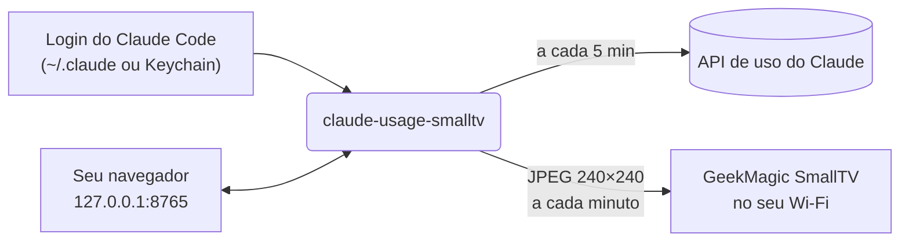

<div align="center">


# claude-usage-smalltv

**O consumo do seu plano Claude, ao vivo num display minúsculo na sua mesa.**

Veja quanto resta da sessão de 5 horas e do limite semanal com uma olhada, sem abrir o app nem digitar `/usage`.

[](https://github.com/brunodesamachado/claude-usage-smalltv/actions/workflows/ci.yml)


[Comprar o display](#-comprar-o-display) · [Início rápido](#-início-rápido) · [Tutorial passo a passo](#-tutorial-passo-a-passo) · [Atualizar](#-atualizar) · [Como funciona](#-como-funciona) · [English](README.md)

</div>

## ✨ Recursos

- **Sessão de 5 horas e limite semanal**, com barras que ficam amarelas em 70% e vermelhas em 90%.
- **Contagem regressiva**: "renova em 2h48 · 17:20" na sessão e o dia da semana no limite semanal.
- **Relógio e data**, para o display continuar útil como relógio de mesa.
- **Para onde foi a sua semana**: por exemplo "Claude Code 81% · Chats 19%".
- **Configuração pelo navegador.** Uma página local guia você passo a passo e depois mostra o status ao vivo, com chaves para o idioma do painel, iniciar com o computador e mostrar o IP do display. Sem precisar de terminal.
- **App para Windows, sem Python.** Baixe um `.exe` e dê dois cliques.
- **Nenhum segredo para copiar.** Usa o login que o Claude Code já tem, renovado pelo próprio CLI `claude`.
- **Sem gravar firmware.** Conversa com a API web original do display pelo Wi-Fi.
- **Educado com a API.** O uso é consultado a cada 5 minutos, com recuo progressivo em caso de HTTP 429, enquanto o relógio continua mudando a cada minuto.
- **Se vira sozinho.** Se o display for desligado ou cair do Wi-Fi, o painel volta assim que ele voltar.
- **Reversível.** A configuração guarda as fotos e o tema anteriores do display; um clique devolve tudo.
- **Inglês ou português**, no painel e na página.

<p align="center">
  
  <br><sub>Normal · perto do limite · últimos números conhecidos enquanto a API está indisponível</sub>
</p>

## 📸 Fotos

<!-- Para usar suas fotos, substitua docs/photos/photo-1.jpg, photo-2.jpg e photo-3.jpg
     (paisagem 4:3 fica melhor). Para mais fotos, copie um bloco <td> e aponte para um arquivo novo. -->
<table>
  <tr>
    <td></td>
    <td></td>
    <td></td>
  </tr>
</table>

**Está usando na sua mesa?** [Mande uma foto do seu setup](../../issues/new?template=show_your_setup.yml) e ela pode aparecer aqui.

## 🛒 Comprar o display

O painel roda no **GeekMagic SmallTV**, um display Wi-Fi de 240×240 do tamanho de um cubo de açúcar.

<!-- Troque YOUR-PURCHASE-LINK pelo seu link de loja ou de afiliado. -->
**➡️ [Comprar o GeekMagic SmallTV Ultra](https://YOUR-PURCHASE-LINK)**

<!-- Se for link de afiliado, mantenha o aviso:
<sub>Link de afiliado: comprando por ele você apoia o projeto sem pagar nada a mais.</sub>
-->

| Firmware do display | Situação |
| --- | --- |
| **SD PRO** ("Smart Weather Clock", [JUZIPi-tech/SD_PRO](https://github.com/JUZIPi-tech/SD_PRO)) | ✅ Testado |
| **Firmware original GeekMagic** (SmallTV / SmallTV-Ultra) | ⚠️ Experimental: [conte como foi](../../issues) |

Não sabe qual é o seu? Abra `http://<ip-do-display>/` no navegador: o SD PRO mostra a página **Smart Weather Clock**, com uma seção de firmware "SD PRO". A página de configuração também detecta sozinha.

## 🚀 Início rápido

Você precisa de um **plano Claude Pro ou Max** e do **[Claude Code](https://code.claude.com/docs/en/overview)** com login feito no mesmo computador.

**Windows, sem precisar de Python**

1. Baixe o `claude-usage-smalltv.exe` da [última release](../../releases/latest) e mova para uma pasta onde ele possa ficar (por exemplo, Documentos): o "Iniciar com o computador" roda ele de lá.
2. Dê dois cliques. A página de configuração abre no navegador; siga os 4 passos.

**macOS, Linux ou Windows com Python 3.10+**

```bash
pipx install git+https://github.com/brunodesamachado/claude-usage-smalltv
claude-usage-smalltv        # inicia o serviço e abre a página de configuração
```

Sem pipx? `pip install git+https://...` também funciona.

## 📖 Tutorial passo a passo

<details open>
<summary><b>1. Conecte o display ao Wi-Fi</b></summary>

Na primeira vez que liga, o SmallTV cria uma rede Wi-Fi própria. Conecte o celular nela, abra `http://192.168.4.1` e escolha a rede da sua casa. Use uma rede de **2,4 GHz**: o chip ESP8266 do display não tem 5 GHz.

Alimente com um carregador de celular de **5 V / 1 A ou mais**. Porta USB fraca faz o Wi-Fi cair.
</details>

<details open>
<summary><b>2. Faça login no Claude Code</b></summary>

Instale o [Claude Code](https://code.claude.com/docs/en/overview) e rode `claude` uma vez para entrar com sua conta Pro ou Max. Esse login é tudo de que a ferramenta precisa: ela lê o token que o Claude Code guarda (`~/.claude/.credentials.json`, ou o Keychain no macOS) e nunca pede senha, cookie ou chave de API.
</details>

<details open>
<summary><b>3. Abra a página de configuração</b></summary>

Dê dois cliques no `claude-usage-smalltv.exe`, ou rode `claude-usage-smalltv` se instalou com pipx. A página abre em **http://127.0.0.1:8765**.

> **"O Windows protegeu o computador"?** O `.exe` não tem assinatura digital, então o SmartScreen avisa na primeira vez. Clique em **Mais informações → Executar assim mesmo**. Cada release é gerada pelo GitHub Actions a partir do código deste repositório.
</details>

<details open>
<summary><b>4. Siga o assistente</b></summary>

<p align="center"></p>

1. **Login do Claude**: conferido para você. Se faltar, a página diz o que rodar.
2. **Encontre seu display**: clique em **Procurar na minha rede**, ou digite o IP que o display mostra logo depois de ligar.
3. **Idioma do painel**: escolha um e veja a prévia ao vivo com os seus números reais.
4. **Coloque o painel no display**: ele vira a única imagem na tela. Suas outras fotos **só ficam ocultas, nunca são apagadas**, e as configurações anteriores ficam salvas para você desfazer tudo. Deixe **Iniciar sozinho** marcado para o painel continuar atualizando depois de reiniciar o computador.

> **Dica:** reserve o IP do display no DHCP do roteador, assim ele nunca muda.
</details>

<details open>
<summary><b>5. No dia a dia</b></summary>

Não precisa fazer nada: o relógio atualiza a cada minuto e o uso a cada 5 minutos. Abra **http://127.0.0.1:8765** quando quiser (salve nos favoritos) para:

- ver se o display está atualizado, o que ele mostra agora e o seu uso;
- trocar o idioma do painel, iniciar com o computador ou **mostrar o IP do display** em letra pequena debaixo do logo;
- ver a atividade recente, trocar de display ou **devolver o display**, que traz de volta suas fotos e o tema anteriores.
</details>

## 🔄 Atualizar

**`.exe` do Windows**: baixe a versão nova da [última release](../../releases/latest). Antes de substituir o arquivo antigo, feche a cópia que está rodando: Gerenciador de Tarefas → **Detalhes** → `claude-usage-smalltv.exe` → **Finalizar tarefa**. Depois coloque o arquivo novo no mesmo lugar e dê dois cliques.

**pipx**: rode `pipx upgrade claude-usage-smalltv` e reinicie o serviço:

| Sistema | Comando para reiniciar |
| --- | --- |
| Windows | `Stop-ScheduledTask claude-usage-smalltv; Start-ScheduledTask claude-usage-smalltv` |
| macOS | `launchctl kickstart -k gui/$(id -u)/dev.claude-usage-smalltv` |
| Linux | `systemctl --user restart claude-usage-smalltv` |

Suas configurações são mantidas: elas ficam no `config.json`, fora do programa (veja [Configuração](#%EF%B8%8F-configuração)).

## 🔁 Iniciar automaticamente

Use a chave **Iniciar com o computador** na página de configuração. Ela registra o serviço para o seu próximo login (nunca inicia uma segunda cópia ao lado da que já está rodando):

| Sistema | O que a chave cria |
| --- | --- |
| Windows | Uma tarefa `claude-usage-smalltv` no Agendador de Tarefas, no logon, sem limite de tempo, também na bateria |
| macOS | `~/Library/LaunchAgents/dev.claude-usage-smalltv.plist` |
| Linux | `~/.config/systemd/user/claude-usage-smalltv.service` (logs: `journalctl --user -u claude-usage-smalltv -f`) |

No Windows o serviço roda sem janela de console; os logs vão para `%LOCALAPPDATA%\claude-usage-smalltv\claude-usage-smalltv.log`.

## ⌨️ Linha de comando (avançado)

Tudo o que a página faz também existe como comando. Sem `HOST`, eles usam o último display configurado.

```bash
claude-usage-smalltv scan            # procura displays na sua rede
claude-usage-smalltv doctor [HOST]   # confere login, API de uso e display (só lê)
claude-usage-smalltv preview --demo  # desenha o painel num PNG, sem display
claude-usage-smalltv setup HOST      # deixa só o painel no display (desfazer: restore)
claude-usage-smalltv run [HOST]      # o serviço: atualiza o display e serve a página
claude-usage-smalltv restore [HOST]  # devolve o display
```

```
$ claude-usage-smalltv doctor 192.168.1.50
Claude
  [ok] login            plan pro, token valid for 422 min
  [ok] usage endpoint   session 18%, weekly 46%
Display at 192.168.1.50
  [ok] network          port 80 open in 2479 ms
  [ok] firmware         SD PRO
```

## 🧠 Como funciona



1. **Uso**: os mesmos dados do comando `/usage` do Claude Code, vindos de `api.anthropic.com/api/oauth/usage` e autenticados com o próprio token OAuth do Claude Code. Quando o token vence, o `claude auth status` (CLI oficial) renova; esta ferramenta nunca grava credenciais.
2. **Desenho**: o [Pillow](https://python-pillow.org) desenha o painel. O símbolo laranja é desenhado em código, sem arquivos de imagem.
3. **Display**: a imagem é enviada por HTTP para o armazenamento de fotos do display, sobrescrevendo o quadro anterior. O driver de cada firmware é escolhido automaticamente sondando o aparelho. Se o display parar de responder, ele é sondado de novo a cada minuto.
4. **Página de configuração**: o mesmo processo serve uma página pequena e uma API JSON só em `127.0.0.1`, feitas com a biblioteca padrão do Python e JavaScript puro, sem dependências extras.

As partes são pequenas e testadas isoladamente: `credentials` → `usage` → `render` → `devices` → `daemon`, conduzidas pelo `service`, com `web` e `cli` por cima.

## ⚙️ Configuração

A página salva as configurações no `config.json` da pasta do app: `%LOCALAPPDATA%\claude-usage-smalltv` no Windows, `~/Library/Application Support/claude-usage-smalltv` no macOS, `~/.local/state/claude-usage-smalltv` no Linux. Os backups da configuração do display também ficam lá.

| Opção | Padrão | O que faz |
| --- | --- | --- |
| Argumento `HOST` ou variável `SMALLTV_HOST` | o display salvo | IP ou nome do display |
| `--lang en\|pt` ou `CLAUDE_USAGE_LANG` | o salvo, senão `en` | Idioma do painel |
| `run --port PORTA` | `8765` | Porta da página de configuração |
| `run --no-web` | — | Não serve a página de configuração |
| `run --open` | — | Abre a página no navegador (é o que acontece quando nenhum comando é passado) |
| `run --usage-interval SEGUNDOS` | `300` | Frequência da consulta de uso. Valores menores arriscam HTTP 429. |
| `run --once` | — | Envia um quadro e sai (útil com cron) |
| `--log-file CAMINHO` | — | Também grava os logs num arquivo |
| `-v` | — | Logs detalhados |
| Variável `CLAUDE_CONFIG_DIR` | `~/.claude` | Onde o Claude Code guarda o login |

Valores passados na linha de comando valem mais que os salvos, e também são salvos.

## 🩺 Solução de problemas

| Sintoma | Solução |
| --- | --- |
| A página diz que o display não está respondendo | Confira se ele está ligado na tomada e no Wi-Fi. Não precisa fazer mais nada: o painel volta sozinho. |
| O display ganhou outro IP | Na página, clique em **Trocar de display** e procure de novo. Depois reserve o IP no roteador e ligue **Mostrar o IP no display** para sempre ver o endereço. |
| A busca não acha o display | Ele pode estar dormindo. Digite o IP que aparece na tela logo depois de ligar. |
| "O Windows protegeu o computador" | O `.exe` não tem assinatura digital: **Mais informações → Executar assim mesmo**. |
| A página não abre | O serviço pode não estar rodando: abra o `.exe` (ou o `claude-usage-smalltv`) de novo. Se a porta 8765 estiver ocupada, use `run --port 8766`. |
| Timeouts, vários segundos por requisição | Normal no ESP8266. Aproxime do roteador e use um carregador de 5 V / 1 A. A ferramenta tenta de novo sozinha. |
| Rodapé amarelo "dados de 14:07 · tentando de novo" | A API de uso está limitando as requisições (HTTP 429). Os últimos números ficam na tela e tudo volta sozinho. Outras ferramentas consultando `/usage` também contam. |
| Rodapé vermelho "faça login: rode `claude`" | O Claude Code saiu da conta. Rode `claude` uma vez. |
| Outras fotos continuam aparecendo | Configure o painel de novo ou desmarque-as na página de fotos do display. |

## 🔒 Privacidade e segurança

- Seu token OAuth é lido localmente e enviado **apenas** para `api.anthropic.com`. Esta ferramenta nunca o registra em log, imprime, mostra na página ou grava.
- A página de configuração só escuta em `127.0.0.1`, então outros aparelhos da sua rede não conseguem abri-la. Requisições de outros sites abertos no seu navegador são recusadas (conferência dos cabeçalhos `Host` e `Origin`, ações só em JSON).
- O resto fica na sua rede: o display é acessado por HTTP na sua LAN.
- O endpoint `/config` do firmware SD PRO devolve a **senha do seu Wi-Fi em texto puro**. Esta ferramenta lê só o campo `theme` e descarta o resto.
- Endpoints que reiniciam o display, atualizam firmware, mudam o Wi-Fi ou apagam arquivos nunca são chamados.

## 🤝 Projetos relacionados

- [Claude-Code-Usage-Monitor](https://github.com/Maciek-roboblog/Claude-Code-Usage-Monitor): monitor de uso no terminal.
- [geekclock-claude](https://github.com/egerkuzma/geekclock-claude): o mesmo display, usando a sessão web do claude.ai.
- [claude-usage-stick](https://github.com/oauramos/claude-usage-stick): firmware próprio de ESP32 para placas LilyGo.

## 🛠️ Desenvolvimento

```bash
git clone https://github.com/brunodesamachado/claude-usage-smalltv
cd claude-usage-smalltv
python -m venv .venv && source .venv/bin/activate   # Windows: .venv\Scripts\activate
pip install -e ".[dev]"
pytest && ruff check . && ruff format --check .
python scripts/generate_assets.py                   # regera as imagens de docs/
pip install -e ".[build]" && python scripts/build_exe.py   # .exe do Windows em dist/
```

Publicar uma release no GitHub gera o `.exe` e anexa à release (`.github/workflows/release.yml`). Drivers para novos firmwares são bem-vindos: veja o [CONTRIBUTING.md](CONTRIBUTING.md).

## ⚖️ Aviso

Projeto não oficial, sem vínculo com a Anthropic ou a GeekMagic e sem endosso delas. "Claude" é marca registrada da Anthropic. Os dados de uso vêm de um endpoint não documentado usado pelo Claude Code, que pode mudar sem aviso.

## 👤 Autor

Feito por **Bruno Machado**. Vamos nos conectar no [LinkedIn](https://www.linkedin.com/in/brunodesamachado).

## 📄 Licença

Livre e de código aberto, sob a [Licença MIT](LICENSE) © Bruno Machado.

Você pode usar, copiar, modificar, mesclar, publicar, distribuir, sublicenciar e vender, para uso pessoal ou comercial, sem pagar nada. A única condição é manter o aviso de copyright e de licença nas cópias do código.

<div align="center">
<sub>Se isso deixou sua mesa um pouco mais legal, uma ⭐ ajuda outras pessoas a encontrarem o projeto.</sub>
</div>
